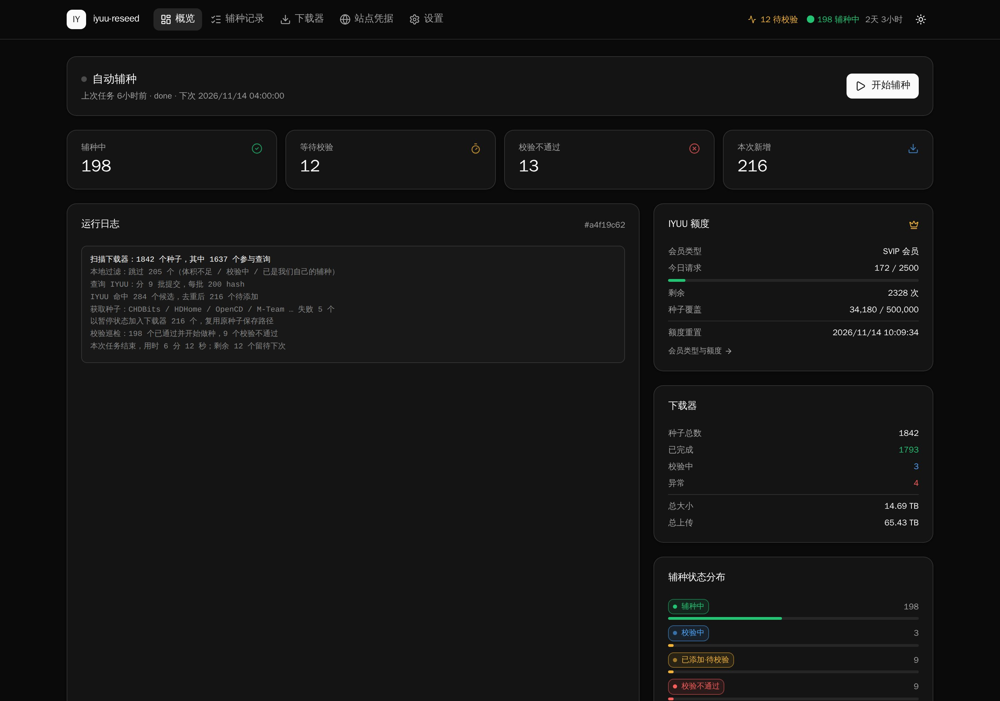
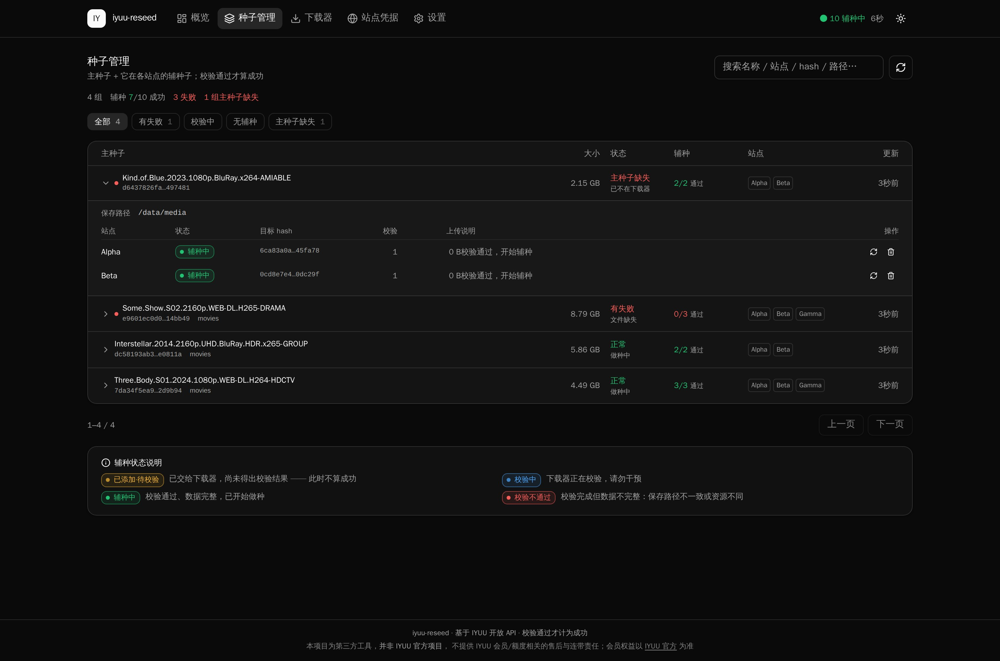
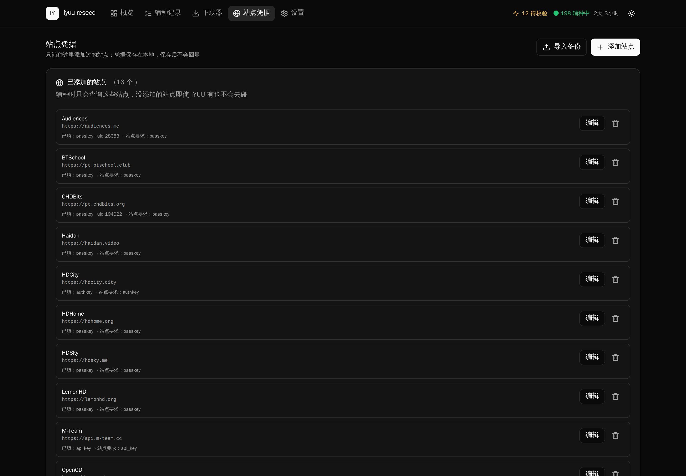
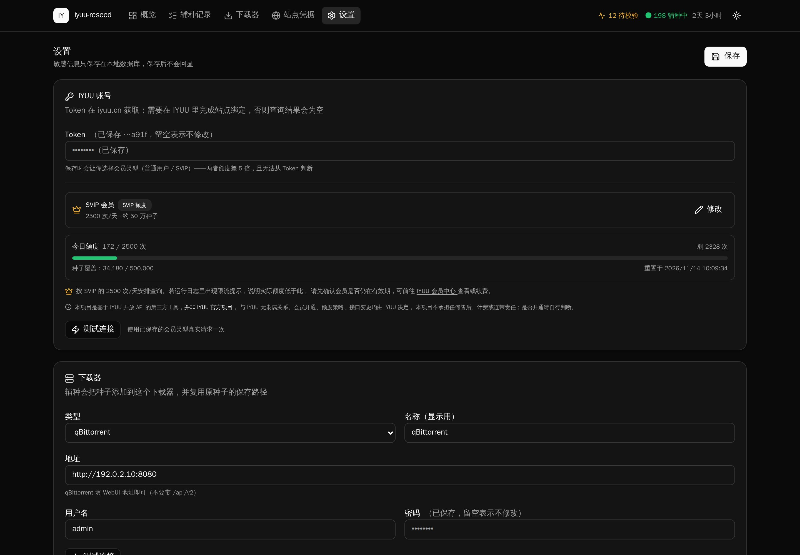
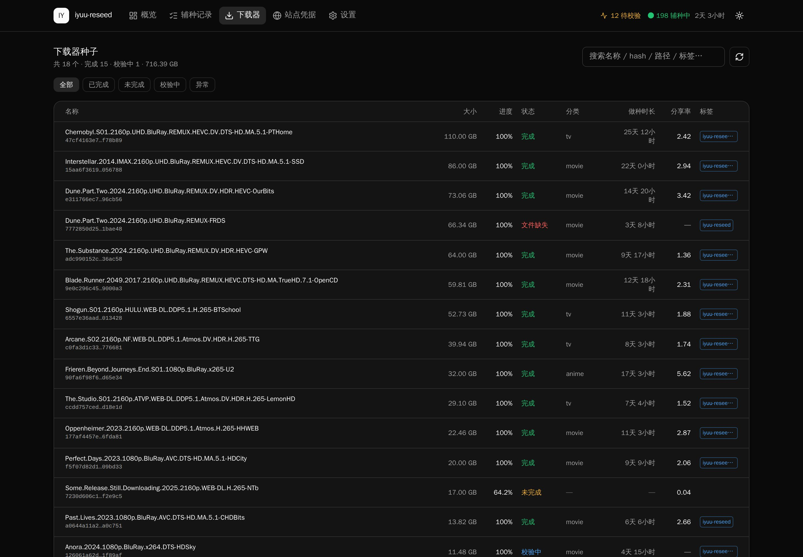

<div align="center">

# IYUU Reseed

**用 IYUU 开放 API 做 PT 自动辅种：Rust 服务端 + Vue 控制台，一个容器、一个 SQLite 文件就是全部状态。**

[](https://github.com/hexgu/iyuu-rust/actions/workflows/ci.yml)
[](LICENSE)
[](CHANGELOG.md)
[](rust-toolchain.toml)
[](web/package.json)
[](https://github.com/hexgu/iyuu-rust/pkgs/container/iyuu-rust)

支持 **qBittorrent** 与 **Transmission** · 密钥只进不出 · 自托管 · MIT

</div>

<p align="center">
  
</p>

> ### ⚠️ 非官方项目声明
>
> 本项目**不是** IYUU（iyuu.cn）的官方客户端，只是通过它公开的 API 查询辅种数据，与
> IYUU 没有任何隶属、合作或代理关系。
>
> - **账号与会员售后归 IYUU**：Token、会员开通续费、额度策略、接口变更、站点绑定失败，都由 IYUU 官方负责。
> - **不代收费用**：程序里出现的会员入口只跳转 IYUU 官方页面，本项目不卖会员、不代开通、不拿分成。
> - **不保证接口长期可用**：IYUU 的限流与权益可能随时调整，由此造成的查询失败、额度不足或账号受限，本项目不承担连带责任。
> - 辅种受各 PT 站规则约束，H&R、分享率、允许辅种的资源类型请自行确认。
>
> 会员权益与价格以 [IYUU 官方会员中心](https://iyuu.cn/app/user/member) 为准。

---

## 目录

- [它解决什么问题](#它解决什么问题)
- [功能](#功能)
- [界面](#界面)
- [快速开始](#快速开始)
- [辅种是怎么跑的](#辅种是怎么跑的)
- [辅种状态机](#辅种状态机)
- [IYUU 额度与会员类型](#iyuu-额度与会员类型)
- [站点凭据与站点适配](#站点凭据与站点适配)
- [设置项](#设置项)
- [环境变量](#环境变量)
- [HTTP API](#http-api)
- [常见问题](#常见问题)
- [使用注意](#使用注意)
- [开发与贡献](#开发与贡献)
- [更新日志](#更新日志)
- [License](#license)

---

## 它解决什么问题

市面上已有的辅种插件长期跑下来会出现「加了一堆辅种，结果全停在暂停」的现象。把源码摊开看，原因几乎总是同一类状态机缺陷：

| 症状 | 根因 |
| --- | --- |
| 校验中的种子被放弃 | 没有处理 `checkingDL` 之类的校验态，把「还在校验」当成「不能做种」 |
| 种子永远停在未校验 | 只补发一次校验请求；qB 5.3+ 移除 `skip_checking` 后，一次没成功就再也没人管 |
| 重启后全部卡住 | 校验队列放在内存里，进程一重启，所有在途校验凭空消失 |
| 统计说成功、实际没几个 | 在「已添加」时就计数成功，压根不管后面校验过不过 |

本项目的做法是把这些地方全部显式化：

1. **每个下载器状态都有分支**，`checkingDL / checkingResumeData / stoppedDL / stoppedUP / missingFiles` 各有去处，校验中既不算成功也不算失败。
2. **校验队列落库**：进程重启后从 SQLite 读回 `added / verifying` 记录继续推进，而不是从零开始。
3. **`added` 与 `seeding` 分开统计**：只有观察到「进度 100% 且不在校验」才算辅种成功。
4. **不提供「跳过校验」开关**：保存路径不一致时跳过校验，qB 会从 0% 重下整个资源，直接烧掉分享率——而这正是工具要防的事。

## 功能

| | |
| --- | --- |
| 🔁 **发现 / 校验两阶段** | 扫描→过滤→查询→添加，与独立的校验巡检循环解耦；IYUU 挂了或没排定时任务，校验照样继续 |
| 💾 **全量持久化** | 辅种记录、在途校验、额度台账、配置都在 SQLite 里，重启不丢 |
| 📊 **11 态状态机** | 从 `pending` 到 `seeding / verify_failed / timed_out`，绝不把「已添加」当成功 |
| 🚦 **四层限流** | 预算 + 持久化台账 + 固定间隔节流 + 熔断；额度不够时截断并留待下次，而不是中途报错 |
| 🌐 **多站点下载机制** | NexusPHP 模板、详情页解析、M-Team API Key、Monika RSS，按站点特征自动选路 |
| 📥 **AutoSeed 备份导入** | 直接读 IYUU AutoSeed 的 `cn_sites_*.json`，先预览再落地，禁用的站点不会被偷偷打开 |
| 🗂️ **站点按需添加** | 只显示你添加过的站点，其余上百个不铺出来；每站只填它真正需要的字段 |
| ⏰ **cron 定时辅种** | 5 字段表达式，按容器本地时区触发，改配置无需重启 |
| 🌱 **主种子 + 辅种子** | 一份数据一组：主种子在上、各站辅种折叠在下面；跨站靠「大小 + 名称」识别同一份数据 |
| 🎨 **现代控制台** | Vue 3 + TypeScript + Tailwind v4 + shadcn-vue，深色模式，浅色可切 |
| 🔒 **默认收敛** | 密钥只写不回显、API 主机名不进浏览器、compose 默认只发布到 `127.0.0.1` |

## 界面

<table>
<tr>
<td width="50%"><br><sub><b>概览</b> — 运行日志、额度、下载器概况、状态分布</sub></td>
<td width="50%"><br><sub><b>种子管理</b> — 下载器里的资源按主种子聚合，跨站副本折叠，失败与主种子缺失一眼可见</sub></td>
</tr>
<tr>
<td><br><sub><b>站点凭据</b> — 只辅种你添加过的站点，支持备份导入</sub></td>
<td><br><sub><b>设置</b> — Token、会员类型、下载器、辅种行为</sub></td>
</tr>
</table>

<p align="center">
  <br>
  <sub><b>下载器</b> — 浏览下载器里的全部种子，按状态 / 标签 / 路径筛选</sub>
</p>

「种子管理」页怎么把同一份数据认成一组、主种子怎么判定、组状态怎么来的，见
[种子管理设计说明](docs/seeds-management.md)——那是这套页面结构的实现契约。

## 快速开始

### Docker Compose（推荐）

镜像由 GitHub Actions 构建并发布到 GitHub Container Registry，`linux/amd64` 与 `linux/arm64` 都有。
仓库里的 [`compose.yml`](compose.yml) 是一份可直接上生产的配置：只监听回环、只读根文件系统、
能力全部丢弃后按需授予、进程以 uid 10001 而非 root 运行、日志轮转、健康检查、资源与进程数上限、
优雅退出都已设好。`./data` 的属主由容器入口自动纠正，升级时不用手工 chown。

```bash
git clone https://github.com/hexgu/iyuu-rust.git
cd iyuu-rust
docker compose up -d
```

打开 <http://localhost:8098>。

默认只绑定 `127.0.0.1:8098`，由宿主机上的反向代理对外提供服务。**控制台没有账号体系，
能打开它的人就能用你的凭据去辅种**，因此不要直接把它暴露到公网。

```nginx
# 反向代理示例（Nginx）
location / {
    proxy_pass http://127.0.0.1:8098;
    proxy_set_header Host $host;
    proxy_set_header X-Real-IP $remote_addr;
}
```

想自己构建镜像：`docker compose up -d --build`。不想用 compose 也可以直接跑：

```bash
docker run -d \
  --name iyuu-reseed \
  --restart unless-stopped \
  -p 127.0.0.1:8098:8098 \
  -v ./data:/data \
  -e TZ=Asia/Shanghai \
  ghcr.io/hexgu/iyuu-rust:latest
```

> 镜像地址 `ghcr.io/hexgu/iyuu-rust`，可用标签 `latest` / `0.4.3` / `0.4`（版本标签不带 `v` 前缀）。
> 镜像只在发版时构建：推 `v*.*.*` tag 会同时产出多架构镜像与 GitHub Release。
> 生产环境建议锁到具体版本（例如 `0.4.3`）而不是 `latest`，升级时再改标签。
> GHCR 在部分网络下需要登录：`echo $GITHUB_TOKEN | docker login ghcr.io -u <用户名> --password-stdin`。

### 首次配置

打开页面后进入「设置」：

1. 填 IYUU Token（[iyuu.cn](https://iyuu.cn) 获取），**选择会员类型**（普通 / SVIP），保存后点「测试连接」。
   测试只发一次请求，「已激活」与否会直接告诉你下一步该做什么。

2. **激活 Token**：IYUU 的 Token 必须用一个**合作站点**的账号激活，否则所有接口都会返回
   `403 用户未绑定推荐站点`。在「设置 → 合作站点与 Token 激活」里获取合作站点列表，选一个你有的站，
   填站点用户数字 ID 与 passkey 绑定即可（passkey 只在本机做 sha1，原始值不出本机）。
   激活后会自动拉一次站点目录，不用再手点刷新。

   > **合作站点 ≠ 可辅种站点**。`/reseed/sites/recommend` 是「能让 Token 生效的站点」，
   > `/reseed/sites/index` 才是「IYUU 已适配、可以往里辅种的站点」。两者是不同的列表。

3. 选下载器类型，填地址与账号，点「测试连接」。
4. 到「站点凭据」页点「添加站点」，从 IYUU 站点目录里挑要辅种的站点，再填它真正需要的字段（多数站点只要 passkey；M-Team 要 API Key，Monika 要 RSS 链接）。

   > 默认一个站点都不启用。只有你添加过的站点才会被查询——没添加的站点即使 IYUU 有资源也不会碰，避免把额度花在不需要的站上。

   > 从 IYUU AutoSeed（或 MoviePilot 的辅种插件）迁移过来时，可以点「导入备份」选 `cn_sites_*.json`。导入先列出「会导入谁 / 跳过谁 / 为什么跳过」让你确认；AutoSeed 里处于禁用状态的站点只会被报告，不会被悄悄开启。

5. 回概览页点「开始辅种」。

> **容器里的地址怎么写**：辅种服务在容器内，`127.0.0.1` 指容器自己。qBittorrent 跑在宿主机或局域网其他机器上时，
> 要填宿主的局域网 IP（例如 `http://192.168.1.10:8080`），或用 `host.docker.internal`（macOS / Windows）配合 `--add-host`。

### 从源码构建

推荐 Docker 部署。要从源码构建、本地开发或跑测试，见 [CONTRIBUTING.md](CONTRIBUTING.md)。

## 辅种是怎么跑的

两个阶段是刻意拆开的：

```text
发现（手动 / cron 触发）
  扫描下载器已完成种子
      │ 本地过滤：未完成 / 校验中 / 自己的辅种 / 体积 / 标签 / 路径
      ▼
  IYUU 查询（每批 200 个 hash，sha1 签名）
      │ 候选去重：已在下载器 / 已成功 / 已知失败
      ▼
  构造下载链接 → 取 .torrent → 校验 info_hash 一致
      │
      ▼
  以「暂停」加入下载器，复用原种 save_path，关闭自动分类（autoTMM）
      │ 记录落库 state=added
      ▼
校验（独立循环，默认每 15s）
      ├── 仍在校验 ─────────────► verifying（继续等，不算成功/失败）
      ├── 100% 且不在校验 ──────► seeding  ✅ 成功，按设置自动开始做种
      ├── 校验完仍不完整 ───────► verify_failed（多为保存路径不一致）
      ├── missingFiles ────────► missing_files
      └── 超过 3 小时未结束 ────► timed_out
```

为什么这样拆：发现依赖 IYUU，校验只依赖下载器。拆开后，IYUU 限流、调度关闭、甚至你没配定时任务，都不影响已经加进去的种子继续校验到终态。每次网络调用前都先把记录写进库，进程崩溃后重启能接着跑，而不是留下一堆没人管的暂停种子。

几个容易踩的细节：

- **save_path 一律复用原种子**，并强制 `autoTMM=false`。否则 qB 会把辅种挪到分类目录，原文件对不上就变成「文件缺失」。
- **info_hash 按原始字节计算**，不是重新序列化后的 bencode；任何重编码都会让 hash 对不上。
- **.torrent 必须校验**：拿到 HTML 登录页或 hash 不符时直接判失败，不把坏文件塞给下载器。
- **`is_https=0` 的站点走 http**：给纯 http 站点发 https 会在 TLS 握手失败，看起来像站点挂了。

## 辅种状态机

| 状态 | 含义 | 终态 |
| --- | --- | --- |
| `pending` | 已发现，尚未处理 | |
| `skipped` | 本地过滤命中（体积/标签/路径）或已在下载器 | ✓ |
| `fetching` | 正在从目标站点取 .torrent | |
| `added` | 已交给下载器，**尚未得出校验结果** | |
| `verifying` | 下载器正在校验，继续轮询 | |
| `seeding` | 校验通过、数据完整、正在做种 | ✓ |
| `verify_failed` | 校验完成但数据不完整（多为保存路径不一致） | ✓ |
| `missing_files` | 下载器报告文件缺失 | ✓ |
| `fetch_failed` | 取 .torrent 失败 / 站点拒绝 | ✓ |
| `add_failed` | 下载器拒绝添加 | ✓ |
| `timed_out` | 超过 3 小时仍未得出校验结果 | ✓ |

非终态记录按退避策略轮询：5s → 10s → 20s → 30s → 60s → 120s → 300s，总上限 3 小时。
`verify_failed` 不自动重试——反复重试只会污染日志和站点流控，修好路径后点「重新校验」即可。

## IYUU 额度与会员类型

IYUU 的辅种接口按天计量，普通用户和 SVIP 额度差 5 倍。这是使用本工具最先撞到的硬约束，所以程序把它做成一等公民，而不是藏在某个角落。

| | 普通用户 | SVIP 会员 |
| --- | --- | --- |
| 默认入口 | `2025.iyuu.cn` | `vip.iyuu.cn` |
| 辅种查询 | 500 次/天 | 2500 次/天 |
| 种子覆盖 | 约 10 万/天 | 约 50 万/天 |
| 其他权益 | — | 超量免封禁、SVIP 徽章、模板消息 2400 条/天、邀请返佣、免费技术支持 |

每次查询最多带 **200 个 info hash**，所以 500 / 2500 次实际就是 10 万 / 50 万种子。

**会员类型必须由你自己选，程序无法探测。** 两个域名后面是同一套服务，同一个 Token 两边都能用：能返回数据不代表有会员，报错也不代表没有。所以本程序不做探测，只在保存 Token 时让你明确表态，然后：

1. 请求发往该类型对应的入口（可用环境变量覆盖）；
2. **按对应额度做预算**，而不是先花完再被拒；
3. 若实际额度小于你声明的，IYUU 会拒绝，日志里出现限流——这是唯一判据。

### 限流怎么处理

不是简单加个 `sleep`，而是四层，少一层就可能真被限流或封停：

| 层 | 行为 |
| --- | --- |
| 预算 | 按天记账，只按**整批**发放：一个请求带 1 个还是 200 个 hash 都算一次，零散小批不占额度 |
| 持久化 | 用量写进 SQLite；重启不会把额度「清零」，否则下次运行必然超限 |
| 节流 | 每次请求先扣账再发并排队，间隔固定 1200ms，不区分等级（IYUU 按突发限流，与档位无关） |
| 熔断 | 一旦返回「超限 / 频繁 / 429」，进入 30 分钟冷却，期间本地直接拒绝；重试只会把临时限流变成更长封禁 |

额度不够时**截断而不是报错**：跑到一半没额度，已完成的部分照常入库，日志写明「还有 N 个种子留待下次」。查询结果为空和「压根没查」是两回事，不能混为一谈。额度为 0 时在**启动前**就拒绝（HTTP 429 + 重置时间），不会先扫一遍下载器再失败。

### 会员入口

设置页与概览页横幅会提示 SVIP 的额度与专享服务器，并提供跳转到 [IYUU 会员中心](https://iyuu.cn/app/user/member) 的按钮。**这只是个链接**：本项目不代收费用、不代开通、不提供售后，也不会因为你开通而获得分成。

## 站点凭据与站点适配

「站点凭据」页只显示你添加过的站点。添加时从 IYUU 目录里挑一个，表单按该站点的 `reseed_check` 元数据只显示它真正需要的字段（passkey、authkey、uid、cookie 等），其余收进「其他字段」，没有哪个站点会因为字段特殊而配不了。

### 站点目录只拉一次

`/reseed/sites/index` 每次都算一次额度，而这份目录几个月才变一次，所以它的策略是**一次性保留**：

- 安装后第一次运行（或第一次保存 Token、第一次绑定合作站点）自动拉取，写入本地 SQLite `iyuu_sites` 表；
- 之后每次打开页面、每次辅种，都从库里读，**不再请求 IYUU**；
- 只有在「添加辅种站点」弹窗里点**刷新**按钮时才会重新拉取并覆盖整张表（消耗 1 次额度）。

也就是说，页面刷新、重启容器都不会多花额度；想更新目录只有你那一下点击。库里的目录为空时，辅种会直接报错提示去刷新，而不是带着空模板逐个去站点下载失败。

下载机制按站点特征自动选路：

| 类型 | 处理方式 |
| --- | --- |
| 常规 NexusPHP | 用 IYUU 的 `download_page` 模板填 passkey |
| TGG / HDCity / GPW 等（模板含不可解析占位符） | 抓 `details.php` 页面，解析 `torrents.php?action=download` 链接，按 `id=` 精确匹配 |
| M-Team | 用 `x-api-key` 调 `api/torrent/genDlToken` 换下载令牌 |
| Monika | 从 RSS 链接取 rsskey，拼 `torrents/download/{id}.{key}` |

详情页有多个下载链接且没有一个精确匹配 `id` 时，**宁可失败也不猜**——猜错会去给别人的资源做种。

## 设置项

| 配置 | 说明 |
| --- | --- |
| 会员类型 | `free` / `vip`，决定默认入口与每日额度。保存 Token 时弹窗必选 |
| 下载器类型 / 名称 / 地址 / 账号 | qBittorrent 或 Transmission；Transmission 可另填 RPC 路径 |
| qBittorrent 认证方式 | 用户名密码，或 API Key（qB ≥ 5.2，免登录、重启不失效） |
| 最小体积（GiB） | 小于该体积的源种子不参与辅种，0 表示不过滤 |
| 并发获取数 | 同时下载 .torrent 的数量，站点有流控，默认 2，建议 1–3 |
| 不辅种的标签 / 分类 | 命中的源种子跳过 |
| 辅种后添加的标签 | 给每个新辅种打上标记，便于识别与过滤 |
| 默认分类 | 原种没有分类、且不复用原分类时使用 |
| 校验轮询间隔（秒） | 默认 15，越小越及时但下载器负载越高 |
| 不辅种的路径前缀 | 每行一个，例如临时下载盘 |
| 复用原种子分类 | 避免分类目录不同导致文件被移动 |
| 标签中加入站点名 | 方便按目标站点筛选 |
| 校验通过后自动开始 | 关闭则种子保持「已完成但停止」，便于人工确认 |
| 启用定时辅种 / Cron | 5 字段 cron，例如 `0 4 * * *`，默认关闭 |

## 环境变量

| 变量 | 默认值 | 说明 |
| --- | --- | --- |
| `IYUU_API_BASE` | 按会员类型 | 覆盖 IYUU 接口地址（自建反代 / 镜像）。必须带 `http://` 或 `https://`，否则启动时告警并忽略 |
| `TZ` | `Asia/Shanghai` | 容器时区，影响 cron 触发与日志时间 |
| `IYUU_LOG` | `info` | 日志级别，例如 `info` / `iyuu_core=debug,info` |
| `IYUU_DATA_DIR` | `./data` | 数据目录（SQLite + 种子缓存） |
| `IYUU_WEB_DIR` | `./web/dist` | 前端产物目录 |
| `IYUU_LISTEN` | `0.0.0.0:8098` | 监听地址 |

`IYUU_API_BASE` **只从环境变量读，界面上没有这一项，也不会出现在任何 API 响应里**。它属于部署层面（镜像、反代），不该由浏览器决定，更不该出现在截图里：

```yaml
# compose.yml
environment:
  IYUU_API_BASE: https://iyuu.example.com
```

## HTTP API

所有接口在 `/api` 下，错误统一返回 `{error: {kind, message}}`。`kind` 取 `iyuu_auth` / `iyuu_inactive` / `rate_limited` / `config` / `downloader_auth` / `downloader` / `not_found` / `internal`，前端据此给出可操作提示而不是笼统的「出错了」。其中：

- `rate_limited` 对应 HTTP 429，含义是**现在别请求，等重置或换服务器**，不是「再试一次」的信号。
- `iyuu_inactive` 对应 HTTP 403：Token 本身有效，但还没有绑定合作站点（IYUU 返回 `403 用户未绑定推荐站点`）。修法是去设置里绑定一个合作站点，**不是**「检查 Token」。

| 方法 | 路径 | 说明 |
| --- | --- | --- |
| GET | `/health` `/version` `/status` | 健康检查与运行概况 |
| GET | `/quota` | 会员等级、今日额度与重置时间（不含接口主机） |
| GET/PUT | `/config` | 读写配置（密钥只写不回显） |
| POST | `/test/iyuu` `/test/downloader` | 连通性测试（IYUU 侧同时判定 Token 是否已激活，成功时顺带把站点目录写库） |
| GET | `/sites` | 本地库里的 IYUU 辅种站点目录（**不消耗额度**），附 `initialised` / `synced_at` |
| POST | `/sites/refresh` | 重新拉取 `/reseed/sites/index` 并写库（消耗 1 次额度，前端「刷新」按钮） |
| GET | `/partners` | **合作站点**（`/reseed/sites/recommend`）—— 能激活 Token 的站点，不是可辅种站点 |
| POST | `/partners/bind` | 绑定合作站点账号以激活 Token（passkey 在服务端做 sha1 后上行） |
| GET | `/partners/activated` | 检查 Token 是否已激活（消耗 1 次额度） |
| PUT/DELETE | `/sites/{sid}/credentials` | 单站点凭据：合并保存 / 删除（删除即停止辅种该站） |
| POST | `/sites/import` | 导入 AutoSeed 站点备份（`apply: false` 为预览，不写入） |
| GET/POST | `/runs` | 任务列表 / 触发任务 |
| GET | `/runs/progress` | 当前任务实时进度与日志 |
| POST | `/runs/current/cancel` | 取消正在运行的任务 |
| GET | `/seeds` | **种子管理**视图：下载器资源组（主种子 + 折叠的辅种，`filter` / `q` / 分页） |
| POST | `/seeds/tags/rewrite` | 把旧的 `iyuu-reseed*` 标签重写为 `iyuu-rust` |
| POST | `/seeds/cleanup` | 清理主种子已消失的辅种（默认 `dry_run=true`） |
| GET | `/seeds/cleanup` | 最近的清理审计记录 |
| GET | `/attempts` `/attempts/stats` | 辅种记录流水与状态统计 |
| POST | `/attempts/{id}/requeue` | 手动重新校验 |
| DELETE | `/attempts/{id}` | 删除记录（不动下载器） |
| GET | `/downloader/torrents` `/downloader/summary` | 下载器种子浏览与汇总 |

## 常见问题

<details>
<summary><b>能用 qBittorrent 的 API Key 认证吗？</b></summary>

能，需要 qBittorrent ≥ 5.2（WebAPI ≥ 2.14.1）。在 qB 的「设置 → WebUI → API Key」点生成，
把 `qbt_…` 开头的 32 位密钥填进「设置 → 下载器 → 认证方式 = API Key」。

和用户名密码相比，API Key 是**无状态**的：不调 `auth/login`、不依赖 `SID` cookie，
所以 qB 重启 WebUI 之后定时任务照常工作，不会因为会话过期而失败一次。
密钥轮换后旧密钥立即失效，此时日志会明确报「API Key 被拒绝」，重新生成即可。

两种认证方式是多选一，表单上只能选一个；留着旧密码不会被用到，反之亦然。
</details>

<details>
<summary><b>种子加进去了，但一直停在暂停状态？</b></summary>

看「种子管理」页展开那一组里的辅种子状态。`added` / `verifying` 表示还在等下载器校验结果；
`verify_failed` 说明校验完了但数据不完整，绝大多数是 **save_path 与原种不一致**。
本程序会强制复用原种子的保存路径，所以更常见的原因是原种子本身已被移动过。修正路径后点「重新校验」。
</details>

<details>
<summary><b>日志里出现「限流」，是被封了吗？</b></summary>

不是封禁，是 IYUU 拒绝了超额请求。程序会进入 30 分钟冷却并停发请求。
先确认「设置」里的会员类型与实际持有等级一致——声明成普通用户却用着 SVIP 会白白浪费额度；
声明成 SVIP 但账号是免费账号，超额部分会被 IYUU 拒绝。
</details>

<details>
<summary><b>数据存在哪里？重装容器会丢吗？</b></summary>

`/data/iyuu.db`（SQLite）一个文件就是全部状态：配置、凭据、辅种记录、在途校验队列、额度台账。
挂载 `/data` 就不会丢。**注意库里是明文凭据**（IYUU Token、各站点 passkey、下载器密码），
别提交到仓库或分享出去。
</details>

<details>
<summary><b>能只辅种一部分站点吗？</b></summary>

能，而且默认就是。只有你在「站点凭据」页添加过的站点才会被查询，
没添加的站点即使 IYUU 有资源也不会碰。
</details>

<details>
<summary><b>为什么没有「跳过校验」开关？</b></summary>

因为保存路径不一致时跳过校验，会让 qB 从 0% 重新下载整个资源，直接烧掉分享率。
这个工具存在的意义就是防止这件事。
</details>

## 使用注意

- **额度是硬约束**：普通用户 500 次/天最多覆盖约 10 万种子。种子多时，要么分几天跑，要么开通 SVIP（2500 次/天）。
- **会员类型只影响预算，不影响能不能连上**。改一下类型即可，不是故障。
- 辅种是把**已在本地存在的数据**注册到另一个站点，不会重复占盘。前提是 save_path 与原种完全一致。
- 校验不通过的记录不会自动反复重试（会污染日志和站点流控），修好路径后点「重新校验」即可。
- OpenCD 等站有 H&R 要求：辅种不产生下载量，但删种前仍建议确认站点 H&R 列为 GOOD。
- 会员/额度相关提示只是**告知与跳转**，不构成购买建议，也不承担 IYUU 侧售后责任。

## 开发与贡献

欢迎 Issue 与 PR。开发环境、从源码构建、项目结构、测试与代码质量门禁、构建/网络说明，都放在 [CONTRIBUTING.md](CONTRIBUTING.md)。

## 更新日志

各版本改动见 [CHANGELOG.md](CHANGELOG.md)，当前版本 **0.4.3**。

## License

[MIT](LICENSE) © 2026 仙姑本咕

本项目与 IYUU（iyuu.cn）无隶属关系，IYUU 相关名称与服务的所有权利归其各自所有者。
